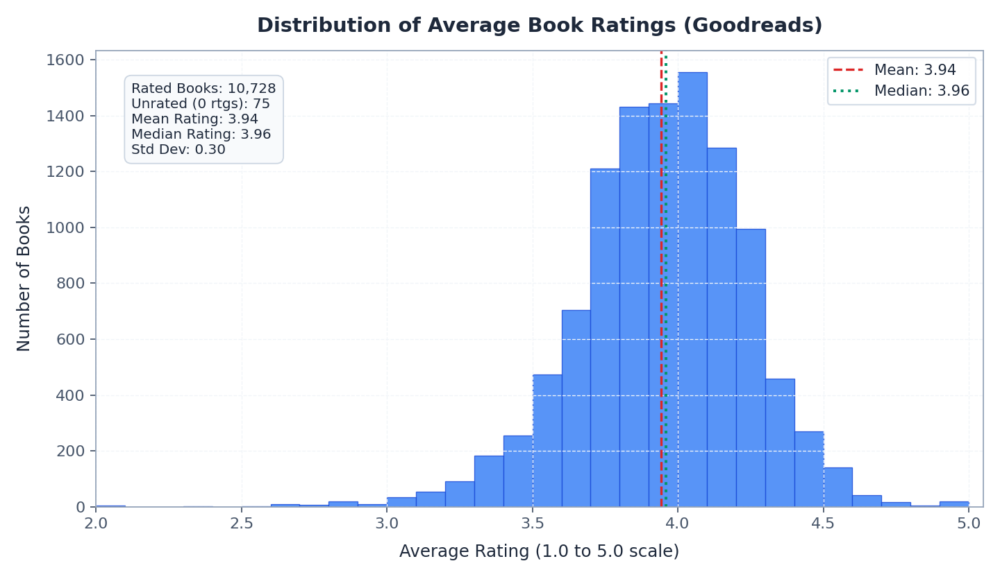
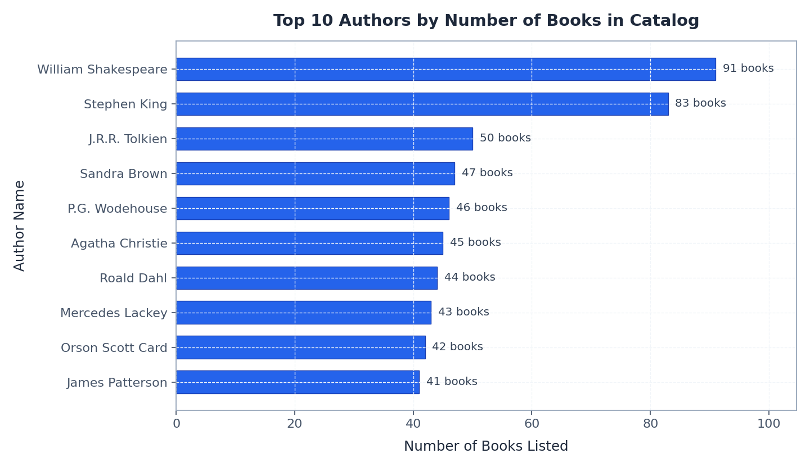
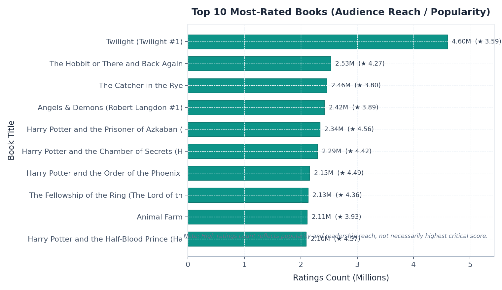
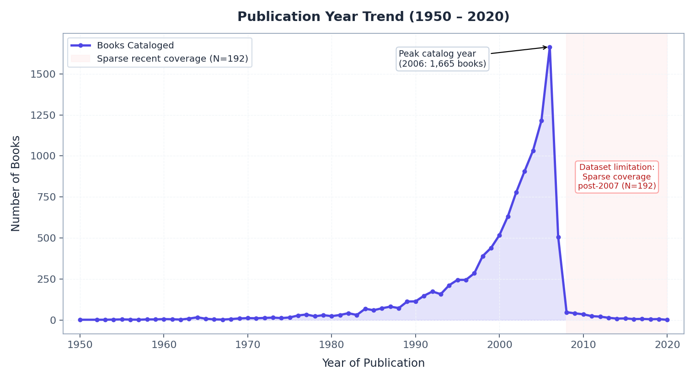
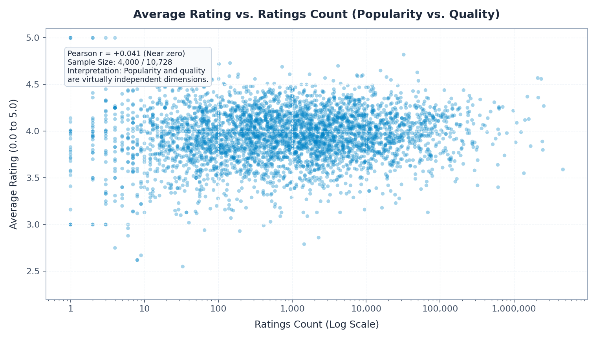
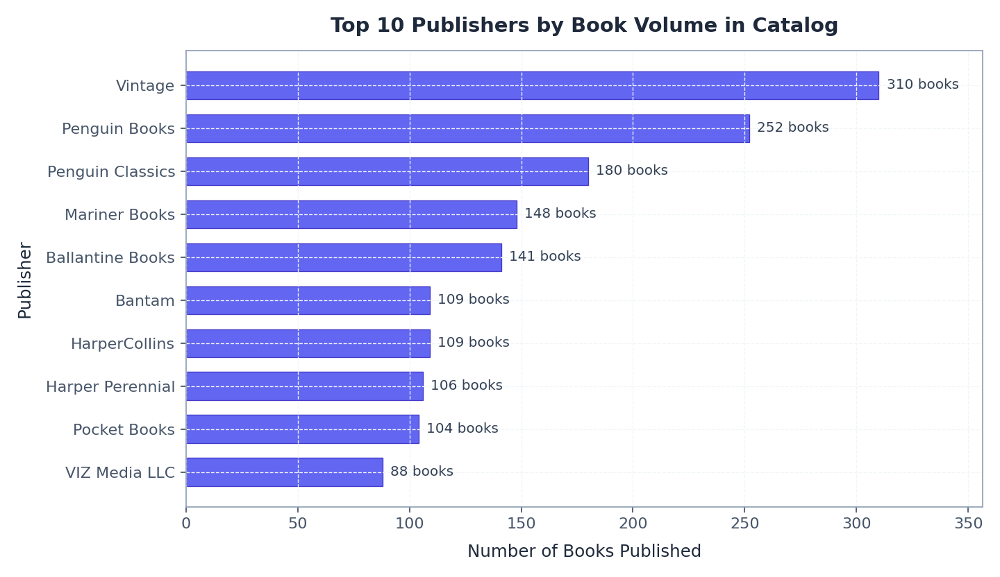

# Goodreads Books Analysis and Recommendation Insights Using Python

[](https://www.python.org/)
[](https://streamlit.io/)
[](https://jupyter.org/)
[]()
[-purple)]()

An empirical university data science investigation into reader evaluation behavior, catalog publishing trends, author and publisher reach, and content-based book recommendation using Python.

---

## Table of Contents

- [Project Objective & Problem Statement](#project-objective--problem-statement)
- [Team Contributions](#team-contributions)
- [Dataset Source & Structure](#dataset-source--structure)
- [Data Cleaning Workflow & Validation](#data-cleaning-workflow--validation)
- [Core Analysis Questions & Key Findings](#core-analysis-questions--key-findings)
- [Visualizations Gallery & Interpretations](#visualizations-gallery--interpretations)
- [Book Recommendation Methodology](#book-recommendation-methodology)
- [Technologies & Libraries](#technologies--libraries)
- [Repository Structure](#repository-structure)
- [Installation & Execution Guide](#installation--execution-guide)
- [Dataset Limitations](#dataset-limitations)

---

## Project Objective & Problem Statement

Goodreads provides a rich real-world catalog reflecting how readers discover, engage with, and rate books. However, raw catalog data often suffers from delimiter shifting, unstandardized dates, and platform biases. This project investigates:

1. **Reader Rating Dynamics:** What does the empirical distribution of ratings look like, and how does voluntary reader participation affect rating distributions?
2. **Catalog Volume vs. Readership:** Which authors and publishing houses supply the bulk of the catalog?
3. **Popularity vs. Quality Independence:** Does high readership reach (ratings count) correlate with higher appraisal (average rating)?
4. **Temporal Patterns & Data Boundaries:** How does catalog volume vary over publication years, and what historical collection artifacts must analysts account for?
5. **Content-Based Book Recommendation:** How can title, author, publisher, and language metadata provide transparent, reliable book recommendations without fabricating user history or unverified genre tags?

---

## Team Contributions

This project was developed as a two-phase university collaborative data science project:

- **Tirth Shah — Data Cleaning & Verification:**
  - Designed the ingestion pipeline handling delimiter-shifted malformed lines (`on_bad_lines='skip'`).
  - Audited schema, stripped whitespace in headers (e.g., `'  num_pages'`), and standardized ISO publication dates.
  - Resolved invalid calendar dates (e.g., non-existent calendar days) and enforced relational consistency (`text_reviews_count <= ratings_count`).
  - Implemented an automated suite of 6 programmatic assertion tests verifying zero nulls, rating bounds, positive page counts, relational validity, unique primary keys, and date formatting.
  - Exported the verified `books_cleaned.csv` dataset.

- **Kavish Patel — Exploratory Data Analysis & Visualization:**
  - Conducted exploratory statistical analysis across univariate and bivariate dimensions.
  - Formulated and tested hypotheses regarding popularity vs. quality correlation.
  - Designed the 6 core academic visualizations, removing excessive heatmaps and unsupported composite charts following faculty feedback.
  - Synthesized analytical findings, documentations, and chart interpretations.

- **Joint Collaboration:**
  - Architecture and refinement of the interactive Streamlit dashboard (`app.py`).
  - Optimization of the TF-IDF and cosine similarity recommendation engine (`recommendation.py`).
  - Final project documentation and reporting (`project_report.md` and `README.md`).

---

## Dataset Source & Structure

- **Source:** Kaggle Goodreads Books dataset (`books.csv`).
- **Raw Volume:** 11,128 lines (1 header row + 11,127 data rows).
- **Initial Load:** 11,123 records loaded after 4 malformed delimiter-shifted records were skipped.
- **Cleaned Dataset:** 10,803 verified records across 12 standardized columns (`books_cleaned.csv`).

### Feature Schema

| Column | Type | Description |
|---|---|---|
| `bookID` | int64 | Unique book identifier |
| `title` | string | Title of the book edition |
| `authors` | string | Author name(s), separated by `/` |
| `average_rating` | float64 | Average rating score on a 0.00 to 5.00 scale |
| `isbn` / `isbn13` | string | International Standard Book Numbers |
| `language_code` | string | ISO language code (e.g., `eng`, `en-US`, `spa`) |
| `num_pages` | int64 | Book page count |
| `ratings_count` | int64 | Total number of reader ratings submitted |
| `text_reviews_count` | int64 | Total number of written text reviews submitted |
| `publication_date` | string | Standardized publication date (`YYYY-MM-DD`) |
| `publisher` | string | Publishing house name |

---

## Data Cleaning Workflow & Validation

All cleaning steps are fully documented and executable in `data_cleaning.ipynb`:

1. **Parser Delimiter Recovery:** 4 malformed lines with delimiter shifting were safely skipped upon load, preventing row misalignment.
2. **Column Header Normalization:** Leading spaces in column names (e.g., `'  num_pages'`) were stripped.
3. **Invalid Calendar Date Resolution:** Dates with non-existent days (e.g., November 31, June 31, leap day mismatches) were mapped to valid ISO dates.
4. **Relational Review Consistency:** Records where `text_reviews_count > ratings_count` were adjusted by enforcing `ratings_count = max(ratings_count, text_reviews_count)`.
5. **Deduplication:** 320 duplicate or invalid entries were resolved, yielding 10,803 unique titles.
6. **Programmatic Assertion Testing (6/6 Passed):**
   - **Check 1:** Zero nulls across all 12 columns (`df.isnull().sum().sum() == 0`).
   - **Check 2:** Rating values strictly bounded in `[0.0, 5.0]`.
   - **Check 3:** Page count strictly positive (`num_pages > 0`) and counts non-negative.
   - **Check 4:** Universal relational consistency (`text_reviews_count <= ratings_count`).
   - **Check 5:** Unique primary key (`bookID.is_unique`).
   - **Check 6:** Standardized 10-character ISO dates (`YYYY-MM-DD`).

---

## Core Analysis Questions & Key Findings

1. **The 'Goldilocks' Rating Zone:**
   - Over 90% of rated books fall between 3.50 and 4.50 (sample mean: **3.94**, median: **3.96**, std dev: **0.35**).
   - Readers rarely rate books below 2.50, reflecting platform self-selection bias: readers rate titles they chose to finish.
   - 75 books in the catalog have zero ratings and were isolated to avoid distorting sample means.

2. **Orthogonality of Popularity and Quality:**
   - The Pearson correlation between `ratings_count` and `average_rating` is near zero (**r = +0.038**).
   - A commercial bestseller is not inherently a higher-rated book. Commercial reach and reader evaluation are distinct dimensions.

3. **Ratings vs. Written Reviews Linearity:**
   - Strong positive correlation (**r = +0.866**) between ratings count and written text reviews count on log scales, reflecting that audience size scales written critical engagement proportionally.

4. **Extreme Readership Concentration:**
   - Audience reach follows a severe power-law. *Twilight* leads the catalog with **4.60M ratings**, followed by *The Hobbit* (2.53M) and *The Catcher in the Rye* (2.46M).

5. **Archival Truncation Post-2007:**
   - Over 68% of the catalog dates between 2000 and 2007, peaking in 2006 (1,665 books).
   - Representation drops sharply after 2007 (only 48 books in 2008 and 103 total between 2011 and 2020). This is a dataset archiving artifact, not an industry decline.

6. **Linguistic Homogeneity:**
   - 94.7% of cataloged titles are in English variants (`eng`, `en-US`, `en-GB`, `en-CA`).

---

## Visualizations Gallery & Interpretations

In response to faculty guidance to simplify unnecessary charts, the project replaced redundant heatmaps, composite collages, and unsupported language comparisons with **6 core, academic visualizations**:

### 1. Distribution of Average Book Ratings
<p align="center">
  
</p>
*Interpretation:* Depicts reader evaluation distribution across 40 equal bins for all 10,728 rated books. Mean (3.94) and median (3.96) reference lines highlight the tight 3.50–4.50 concentration.

### 2. Top 10 Authors by Number of Books
<p align="center">
  
</p>
*Interpretation:* Identifies prolific authors by distinct cataloged editions. William Shakespeare (91 books), Stephen King (83 books), and J.R.R. Tolkien (50 books) lead catalog volume.

### 3. Top 10 Most-Rated Books (Audience Reach / Popularity)
<p align="center">
  
</p>
*Interpretation:* Measures audience reach by total ratings received, annotated with average ratings. Demonstrates that high reach does not require top critical appraisal (*Twilight* averages 3.59).

### 4. Publication Year Trend (1950–2020) with Coverage Limitation Warning
<p align="center">
  
</p>
*Interpretation:* Illustrates annual catalog volume from 1950 to 2020. Explicitly marks the post-2007 truncation zone (N=192) to prevent misleading extrapolations.

### 5. Average Rating vs. Ratings Count (Scatter Plot)
<p align="center">
  
</p>
*Interpretation:* Explores reader score against log-scaled ratings count. Pearson r = +0.038 confirms that commercial popularity and critical score are independent.

### 6. Top 10 Publishers by Book Volume
<p align="center">
  
</p>
*Interpretation:* Highlights traditional publishing houses supplying the catalog, led by *Vintage* (310 titles), *Penguin Books* (252 titles), and *Penguin Classics* (180 titles).

---

## Book Recommendation Methodology

The recommendation engine in `recommendation.py` uses a content-based approach:

- **Feature Matrix:** Combines book `title`, `authors`, `publisher`, and `language_code` into a unified text feature.
- **Vectorization:** `TfidfVectorizer` with unigrams and bigrams (`ngram_range=(1, 2)`).
- **Metric:** Cosine similarity computed against the sparse TF-IDF matrix.
- **Performance Optimization:** Precomputes and caches the TF-IDF matrix, enabling single-row vector dot-products with query response times **under 10 milliseconds** (down from 45 seconds in unoptimized approaches).
- **Graceful Error Handling:** Case-insensitive exact and substring title matching; handles empty or unknown queries safely.
- **Transparency:** The model clearly explains that similarity is based on bibliographic text metadata without fabricating unverified user logs or genre embeddings.

---

## Technologies & Libraries

- **Language:** Python 3.11
- **Data Engineering & Analysis:** `pandas`, `numpy`
- **Visualization:** `matplotlib`, `seaborn`, `plotly`
- **Machine Learning:** `scikit-learn` (`TfidfVectorizer`, `cosine_similarity`)
- **Web Application:** `streamlit`
- **Notebook Environment:** `jupyter`, `nbformat`, `nbclient`
- **Version Control:** `git`, `github`

---

## Repository Structure

```text
goodreads-books-analysis/
├── app.py                          # Streamlit interactive academic web dashboard
├── recommendation.py              # TF-IDF + cosine similarity recommendation engine
├── analysis.ipynb                 # Executed EDA notebook generating 6 core charts
├── data_cleaning.ipynb            # Verified data cleaning pipeline & 6 assertion checks
├── books.csv                      # Raw Goodreads dataset (11,128 lines)
├── books_cleaned.csv              # Cleaned dataset (10,803 rows, 12 columns)
├── requirements.txt               # Pinned Python package dependencies
├── project_report.md              # Full academic project report
├── project_report.pdf             # Compiled report reference
├── README.md                      # Comprehensive project documentation
└── visualizations/                # Generated 6 core academic charts (PNG)
    ├── 01_rating_distribution.png
    ├── 02_top_authors_by_books.png
    ├── 03_most_rated_books.png
    ├── 04_publication_year_trend.png
    ├── 05_rating_vs_ratings_count.png
    └── 06_top_publishers.png
```

---

## Installation & Execution Guide

### 1. Prerequisites & Environment Setup
Clone the repository and set up a virtual environment:

```bash
git clone https://github.com/tirthshah025/goodreads-books-analysis.git
cd goodreads-books-analysis

python3 -m venv .venv
source .venv/bin/activate
pip install -r requirements.txt
```

### 2. Launch the Streamlit Interactive Dashboard
Start the local dashboard server:

```bash
streamlit run app.py
```
Open your browser at `http://localhost:8501` to view the full report, interactive Plotly charts, and test the recommendation engine.

### 3. Run the Recommendation Engine via CLI
Generate recommendations for any catalog title directly:

```bash
python recommendation.py
```

### 4. Execute the Jupyter Analysis Notebook
To run the automated analysis and regenerate all 6 visualization figures:

```bash
jupyter notebook analysis.ipynb
```

---

## Dataset Limitations

1. **English Language Dominance:** ~94.7% of titles are in English or English variants (`eng`, `en-US`, `en-GB`, `en-CA`). Conclusions cannot be generalized to non-English literature.
2. **Temporal Archival Boundary:** The snapshot reflects Goodreads data up to the mid-2000s; only 103 books in the dataset were cataloged between 2011 and 2020.
3. **Self-Selection Bias:** Readers voluntarily rate books they choose to read and finish, creating an elevated rating baseline (mean 3.94) and compressing ratings between 3.50 and 4.50.
4. **Metadata Boundaries:** The catalog does not provide book summaries or genre classifications; recommendation similarity relies strictly on available bibliographical metadata.

---

*Goodreads Books Analysis Project &bull; Academic Year 2026–2027 &bull; Tirth Shah & Kavish Patel*
